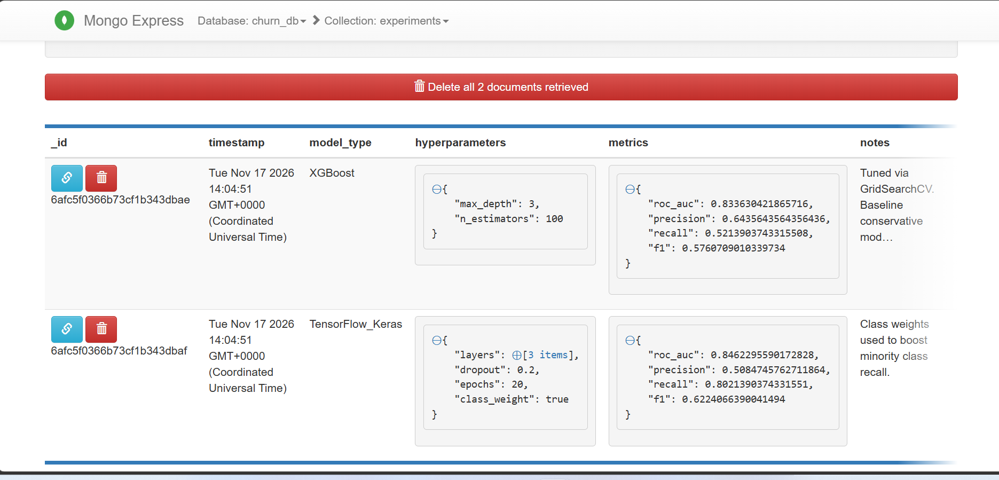

# Telco Churn Prediction Pipeline (MongoDB + Scikit-Learn + TensorFlow)

This repository contains an end-to-end machine learning pipeline that ingests raw customer data into MongoDB, builds a Scikit-Learn preprocessing pipeline, benchmarks an XGBoost baseline against a TensorFlow/Keras Neural Network, and logs the experiment results back into MongoDB. 

The goal of this project is not just to train a model, but to prove an understanding of the full ML lifecycle—from data storage and aggregation to feature engineering, model benchmarking, and production inference.

## Architecture

1. **Ingest:** Raw CSV is cleaned and loaded into MongoDB (`churn_db.raw_customers`).
2. **Explore:** MongoDB aggregation pipelines filter nulls and extract business insights.
3. **Preprocess:** Data is pulled into Pandas. A Scikit-Learn `ColumnTransformer` handles median imputation, standard scaling, and one-hot encoding.
4. **Train & Benchmark:** An XGBoost classifier and a Keras Neural Network are trained on an 80/20 split.
5. **Track:** Metrics and hyperparameters are logged to MongoDB (`churn_db.experiments`).
6. **Infer:** A CLI script takes raw customer JSON, applies the saved pipeline, and outputs churn probability.

## Tech Stack
- **Database:** MongoDB 7.0 (Dockerized), `pymongo`
- **ML & Data:** Scikit-Learn 1.9, XGBoost 3.4, TensorFlow 2.22, Pandas 3.1
- **Environment:** Python 3.14 (Windows), Joblib

*Note on environment: The host system runs Python 3.14.10. Because no stable TensorFlow wheel existed for this version at the time of building, the `requirements.txt` pins a pre-release TF 2.22.0-rc1 and nightly Keras build. Always install with `pip install --pre -r requirements.txt`.*

## Key Engineering Decisions

- **Handling the `TotalCharges` Trap:** The raw dataset stores `TotalCharges` as a string, using a blank space (`' '`) for the 11 new customers with `tenure == 0`. We coerce this to numeric at ingest. During Phase 1 aggregations, we drop these nulls to prove Mongo manipulation skills. However, during model training, we *impute* them using the median. Discarding new customers from training just because they haven't been billed yet is a bad production habit.
- **MongoDB `$facet` Aggregations:** Instead of running multiple round-trip queries to get class averages and overall totals, we use MongoDB's `$facet` stage to compute all statistics in a single server-side pass.
- **The Imbalance Trade-off:** The dataset is 26.5% churners. XGBoost handles this via tree splits. For the Neural Network, we explicitly applied `class_weight="balanced"`. This is why the NN achieves a higher Recall (catching 80% of churners) but suffers a lower Precision (51%), meaning it generates more false alarms. 
- **One-Hot Encoding:** We use `sparse_output=False` in the Scikit-Learn encoder. While sparse matrices save memory, Keras requires dense NumPy arrays for training.

## Experiment Tracking in MongoDB

Metrics and hyperparameters for every training run are automatically logged to the `experiments` collection in MongoDB. This allows us to track model drift over time and compare architectures without relying on local notebook outputs.

## Results & Model Comparison

Both models were evaluated on the same 20% stratified test set.

| Model | ROC-AUC | Precision (Churn) | Recall (Churn) | F1-Score |
| :--- | :--- | :--- | :--- | :--- |
| **XGBoost** (Tuned via GridSearchCV) | 0.8336 | **0.64** | 0.52 | 0.58 |
| **Keras NN** (Dense 32 -> 16 -> 1, class_weight) | **0.8462** | 0.51 | **0.80** | **0.62** |

**The Conclusion:** 
The Keras Neural Network wins on ROC-AUC and F1-Score, but only because it was class-weighted to force it to pay attention to churners. It aggressively flags customers (80% recall), but is wrong 49% of the time it does so. XGBoost is the more conservative model; when it flags a customer, it is correct 64% of the time. In a real-world retention campaign where retention offers cost money, XGBoost's precision profile is often more profitable.

## Phase 1 Business Insights (from MongoDB)

Using aggregation pipelines, we mapped the baseline churn rate by contract type:
- **Month-to-month:** 42.7% churn rate
- **One year:** 11.3% churn rate
- **Two year:** 2.9% churn rate

This validates the business need for the model: targeting month-to-month customers is critical.

## Limitations & Next Steps

- **No NN Hyperparameter Tuning:** The Keras model uses the fixed architecture dictated by the brief. A production pipeline would use KerasTuner or Optuna to find the optimal layer count and learning rates.
- **Static Threshold:** The models use the default `0.5` probability threshold. In reality, we would tune this threshold based on the financial cost of a false positive (wasting a retention discount) versus a false negative (losing a customer).
- **Batch vs. Real-Time Inference:** The CLI script loads the model from disk on every run. For production, this would be wrapped in a FastAPI endpoint to load the model into memory on startup.

## How to Run

**1. Prerequisites**
- Docker Desktop
- Python 3.11+ (Verified on 3.14.10)

**2. Setup**

    git clone https://github.com/your-username/churn-mongo-pipeline.git
    cd churn-mongo-pipeline

    python -m venv .venv
    .venv\Scripts\activate     # Windows
    # source .venv/bin/activate  # macOS/Linux

    pip install --pre -r requirements.txt

**3. Start MongoDB**

    docker compose up -d
    # Mongo-Express UI is available at http://localhost:8081

**4. Run the Pipeline**
Ensure the Telco CSV is saved at `data/Telco-Customer-Churn.csv`.

    python src/ingest.py          # Load raw data to Mongo
    python src/aggregations.py    # Run Phase 1 Mongo aggregations
    python src/train_xgb.py       # Train & GridSearch XGBoost
    python src/train_keras.py     # Train TensorFlow NN
    python src/log_experiments.py # Log metrics to Mongo

**5. Run Inference**
Pass a JSON object of a single customer's raw data to get a prediction:

    python src/predict.py --data "{\"customerID\": \"1234-ABCDE\", \"gender\": \"Female\", \"SeniorCitizen\": 0, \"Partner\": \"No\", \"Dependents\": \"No\", \"tenure\": 2, \"PhoneService\": \"Yes\", \"MultipleLines\": \"No\", \"InternetService\": \"Fiber optic\", \"OnlineSecurity\": \"No\", \"OnlineBackup\": \"No\", \"DeviceProtection\": \"No\", \"TechSupport\": \"No\", \"StreamingTV\": \"Yes\", \"StreamingMovies\": \"Yes\", \"Contract\": \"Month-to-month\", \"PaperlessBilling\": \"Yes\", \"PaymentMethod\": \"Electronic check\", \"MonthlyCharges\": 95.5, \"TotalCharges\": 191.0}"

## Repository Structure

    .
    ├── docker-compose.yml          # mongo:7.0 + mongo-express
    ├── requirements.txt            # pinned deps (pre-release aware)
    ├── README.md
    ├── data/                       # gitignored; dataset lives here
    ├── artifacts/                  # gitignored; saved models & preprocessors
    └── src/
        ├── config.py               # DB connection & centralized settings
        ├── ingest.py               # Phase 1: CSV -> Mongo
        ├── aggregations.py         # Phase 1: Mongo pipelines
        ├── features.py             # Phase 2: Feature engineering & ColumnTransformer
        ├── train_xgb.py            # Phase 3: XGBoost baseline
        ├── train_keras.py          # Phase 3: Keras MLP
        ├── log_experiments.py      # Phase 4: Write metrics to Mongo
        └── predict.py              # Phase 5: CLI inference